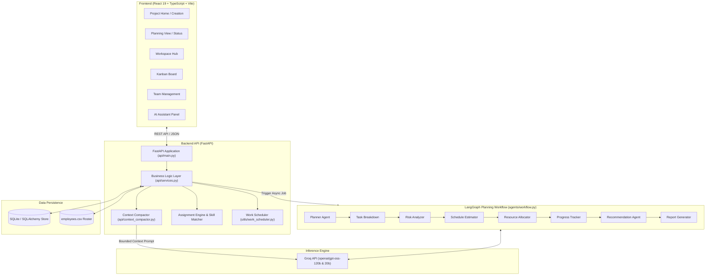

# AIPlanX

AIPlanX is an AI-powered project planning and management platform designed to automate project breakdown, risk analysis, resource scheduling, and ongoing task management. Built with FastAPI, LangGraph, Groq LLMs, and React 19, AIPlanX bridges high-level generative AI planning with deterministic, constraint-based operational scheduling.

---

## Table of Contents

- [Overview](#overview)
- [Key Features](#key-features)
- [System Architecture](#system-architecture)
- [How AIPlanX Works](#how-aiplanx-works)
- [Scheduling and Assignment Logic](#scheduling-and-assignment-logic)
- [Technology Stack](#technology-stack)
- [Project Structure](#project-structure)
- [Getting Started](#getting-started)
  - [Prerequisites](#prerequisites)
  - [Backend Setup](#backend-setup)
  - [Frontend Setup](#frontend-setup)
- [Configuration](#configuration)
- [Usage Guide](#usage-guide)
- [Planned Enhancements](#planned-enhancements)
- [License](#license)

---

## Overview

Traditional project management tools either require manual entry of work breakdowns and schedules or provide disconnected AI chatbots that lack operational awareness. AIPlanX solves this by offering an end-to-end workflow:

1. **Strategic AI Planning:** Generates multi-phase work breakdown structures, risk matrices, and dependency graphs using LangGraph multi-agent pipelines powered by Groq-hosted open-weights LLMs.
2. **Deterministic Operational Execution:** Converts plans into constraint-governed workspaces where capacity limits, weekly employee allocations, skill matching, and task assignments are enforced through mathematical rules rather than unconstrained AI hallucinations.
3. **Context-Aware Assistance:** A project copilot with aggressive context compaction to provide immediate advisory insights within strict API token and rate limits.

---

## Key Features

### 1. AI-Powered Project Planning
- **Multi-Agent Pipeline:** Coordinates sequential agent stages using LangGraph: requirement analysis, task decomposition, risk analysis, schedule estimation, resource allocation, progress tracking, recommendation generation, and executive reporting.
- **Structured Pydantic Validation:** Every agent output conforms to strict schemas to ensure predictable plan generation.
- **Asynchronous Execution:** Long-running planning tasks run in background threads with real-time status polling (`/api/planning-jobs/{job_id}`).

### 2. Management Workspace
- **Overview Dashboard:** Visual metrics displaying overall progress, phase timelines, risk tallies, and delivery estimates.
- **Interactive Gantt / Timeline:** Phase-by-phase timeline visualizing planned dates, durations, and dependencies.
- **Kanban Board:** Dynamic task board supporting drag-and-drop workflow status transitions (`Not Started`, `In Progress`, `Blocked`, `Completed`).
- **Comprehensive Reports:** Markdown and tabular plan summaries covering scope, critical paths, risk mitigation strategies, and resource allocations.

### 3. Team Management
- **Dual-Roster Support:**
  - *Global Planning Roster:* Standardized catalog of full-time employees and interns loaded from persistent data storage (`employees.csv` or database).
  - *Project-Scoped Team Members:* Project-specific roster allowing teams to define customized project personnel (`TM{id}`), roles, billable rates, capacity, and custom skill sets.
- **Workload & Allocation Tracking:** Dynamic monitoring of weekly allocated hours, billable costs, and capacity thresholds.

### 4. Task Assignment, Reassignment & Collaboration
- **Deterministic Skill Matching:** Automatic qualification evaluation comparing task skill prerequisites against candidate employee profiles.
- **Candidate Recommendation Engine:** Multi-factor scoring formula that weights skill match, availability, and seniority.
- **Seamless Reassignment:** Transfer task ownership between members while maintaining assignment integrity and updating workload metrics.
- **Multiple Collaborators:** Assign a primary owner and attach additional collaborators to complex tasks without overwriting existing ownership.
- **Project Member Dialog Integration:** Assign existing project tasks directly during the creation of new team members.

### 5. AI Project Assistant
- **Context-Aware Assistance:** Real-time chat copilot capable of answering questions about tasks, blockers, schedules, team workloads, and recommendations.
- **Context Compaction Engine:** Reduces project context by over 90% (stripping redundant narrative text and compiling dense key-value status tables) to reliably operate within strict LLM token and rate limits (e.g. Groq 8,000 TPM limit).
- **Persistent Chat History:** Scoped per-project chat session persistence across page navigation and browser reloads.
- **Rich Markdown Rendering:** Formatted chat rendering supporting tables, syntax-highlighted code blocks with copy actions, bullet lists, blockquotes, and status badges.

---

## System Architecture



---

## How AIPlanX Works

AIPlanX cleanly separates generative AI planning from operational execution to maintain reliable, verifiable constraints:

1. **Plan Generation (Probabilistic LLM Phase):**
   When a user submits project requirements, an asynchronous LangGraph workflow activates. Specialized agents draft tasks, calculate risk severity, outline sequential dependency paths, and synthesize recommendations into a `ProjectPlan`.
2. **Plan Materialization (Workspace Creation):**
   Upon approval, the `ProjectPlan` is converted into an active workspace stored in the database. Tasks, milestones, and baseline team allocations are persisted as concrete database entities (`tasks`, `projects`, `team_members`).
3. **Execution & Adjustment (Deterministic Engine Phase):**
   During day-to-day operations (task movement, reassignment, collaborator management, capacity planning), AIPlanX relies on deterministic Python algorithms rather than LLM calls. This prevents accidental schedule overwrites, capacity violations, or invalid assignments.
4. **Advisory Copilot (Bounded Context Ingestion):**
   When querying the AI Assistant, the context compactor aggregates active tasks, overdue items, blockers, and member workloads into a compact prompt string, ensuring conversational responses remain grounded in live database state.

---

## Scheduling and Assignment Logic

Task assignment and scheduling in AIPlanX are deterministic and governed by standard mathematical rules.

### 1. Skill Matching & Normalization
Skills are normalized via case-folding, whitespace trimming, and alias resolution (e.g., `postgres` $\rightarrow$ `postgresql`, `js` $\rightarrow$ `javascript`, `reactjs` $\rightarrow$ `react`, `py` $\rightarrow$ `python`).

The skill match ratio is defined as:

$$\text{Skill Match} = \frac{|\text{Required Skills} \cap \text{Candidate Skills}|}{|\text{Required Skills}|}$$

- **Qualification Threshold:** A candidate qualifies for a task if $\text{Skill Match} \ge 0.50$ (50%).
- **Empty Prerequisites:** If a task requires no specific skills, all candidates qualify with a score of $1.0$.

### 2. Candidate Recommendation Score
When evaluating qualified candidates for a task, AIPlanX calculates a composite rank:

$$\text{Score} = 0.65 \cdot \text{Skill Match} + 0.25 \cdot \left(1 - \frac{\text{Workload \%}}{100}\right) + 0.10 \cdot \frac{\min(\text{Experience Years}, 7)}{35}$$

- **Skill Match (65%):** Prioritizes candidates with high technical overlap.
- **Availability (25%):** Balances load by favoring candidates with lower current project commitments.
- **Experience (10%):** Weights proven seniority (normalized against standard baseline tenure).

### 3. Work Schedule & Capacity Allocation
- **Standard Availability:** 40 hours per week per full-time resource.
- **Multi-Week Distribution:** Tasks spanning multiple weeks allocate hours across sequential calendar blocks (`WeeklyAllocation`), ensuring individual weekly capacity is not breached.

---

## Technology Stack

### Backend
- **Language & Runtime:** Python 3.10+
- **Web Framework:** FastAPI (Uvicorn ASGI server)
- **Data Validation:** Pydantic v2
- **Database ORM:** SQLAlchemy (SQLite backend)
- **AI Orchestration:** LangGraph, LangChain Groq

### Frontend
- **Framework:** React 19
- **Language:** TypeScript
- **Build Tool:** Vite 8
- **Styling:** Tailwind CSS v4
- **Icons & Visuals:** Lucide React, Recharts
- **Drag-and-Drop:** Native HTML5 Drag and Drop API

---

## Project Structure

```
AIPlanX/
├── agents/                       # LangGraph multi-agent planning workflow
│   ├── workflow.py               # StateGraph definition and node sequencing
│   ├── planner.py                # High-level architecture and scope planner
│   ├── task_breakdown.py         # Subtask decomposition agent
│   ├── risk_analyzer.py          # Risk evaluation and mitigation agent
│   ├── schedule_estimator.py     # Milestone and critical path estimator
│   ├── resource_allocator.py     # Team skill and role allocation agent
│   ├── progress_tracker.py       # Execution phase monitor
│   ├── recommendation_agent.py   # Strategy and bottleneck advisor
│   └── report_generator.py       # Final plan synthesizer
│
├── api/                          # REST API layer
│   ├── main.py                   # FastAPI route registrations and lifecycle
│   ├── services.py               # Workspace state and persistence services
│   ├── db_models.py              # SQLAlchemy database tables and schemas
│   ├── settings.py               # Application configuration and environment
│   └── context_compactor.py      # AI Assistant token optimization pipeline
│
├── utils/                        # Deterministic computational utilities
│   ├── assignment_engine.py      # Candidate scoring and qualification engine
│   ├── skill_matcher.py          # Skill normalization and intersection logic
│   └── work_scheduler.py         # Multi-week capacity and allocation solver
│
├── frontend/                     # React 19 TypeScript application
│   ├── src/
│   │   ├── pages/                # Top-level route pages (Home, Create, Workspace)
│   │   ├── workspace/            # Workspace modules (Board, Gantt, Team, Reports)
│   │   ├── components/           # Reusable UI components (Markdown, ChatInput)
│   │   ├── api.ts                # Typed client API communication layer
│   │   └── types.ts              # Frontend interface models
│   ├── package.json              # Frontend dependencies and scripts
│   └── vite.config.ts            # Vite bundler configuration and API proxy
│
├── tests/                        # Comprehensive test suite
│   ├── test_assignment_engine.py # Tests for qualification and ranking
│   ├── test_work_scheduler.py    # Tests for multi-week allocation logic
│   ├── test_api.py               # Integration tests for FastAPI endpoints
│   └── test_context_compactor.py # Tests for token budget enforcement
│
├── employees.csv                 # Base global planning roster
├── requirements.txt              # Backend Python dependencies
└── README.md                     # Project documentation
```

---

## Getting Started

### Prerequisites
- **Python:** Version 3.10, 3.11, or 3.12 installed
- **Node.js:** Version 18.x, 20.x, or 22.x with npm installed
- **Groq API Key:** An active API key from [Groq Cloud Console](https://console.groq.com)

---

### Backend Setup

1. **Clone the repository:**
   ```bash
   git clone <repository-url>
   cd AIPlanX
   ```

2. **Create and activate a virtual environment:**
   ```bash
   # On macOS/Linux
   python -m venv venv
   source venv/bin/activate

   # On Windows (PowerShell)
   python -m venv venv
   .\venv\Scripts\Activate.ps1
   ```

3. **Install dependencies:**
   ```bash
   pip install -r requirements.txt
   ```

4. **Configure environment variables:**
   Create a `.env` file in the root directory (refer to [Configuration](#configuration)):
   ```env
   GROQ_API_KEY=your_groq_api_key_here
   AIPlanX_STORE=sqlite
   AIPlanX_DB_PATH=aiplanx.db
   ```

5. **Start the FastAPI backend server:**
   ```bash
   uvicorn api.main:app --host 127.0.0.1 --port 8000 --reload
   ```
   The backend will be live at `http://127.0.0.1:8000` with interactive API docs at `http://127.0.0.1:8000/docs`.

---

### Frontend Setup

1. **Navigate to the frontend directory:**
   ```bash
   cd frontend
   ```

2. **Install dependencies:**
   ```bash
   npm install
   ```

3. **Run the development server:**
   ```bash
   npm run dev
   ```
   The frontend application will be accessible at `http://localhost:5173`. Requests to `/api` are automatically proxied to `http://127.0.0.1:8000`.

---

## Configuration

AIPlanX is configured via environment variables placed in a root `.env` file.

| Variable | Type | Default | Description |
|---|---|---|---|
| `GROQ_API_KEY` | String | *(Required)* | Groq API authentication key for LLM inference. |
| `GROQ_MODEL` | String | `openai/gpt-oss-120b` | Primary LLM model for planning, risk analysis, and assistant. |
| `GROQ_TASK_BREAKDOWN_MODEL` | String | `openai/gpt-oss-20b` | Specialized model for high-throughput task decomposition. |
| `AIPlanX_STORE` | String | `sqlite` | Persistence backend (`sqlite` or `memory`). |
| `AIPlanX_DB_PATH` | String | `aiplanx.db` | File path for SQLite database storage. |
| `CORS_ORIGINS` | String | `http://localhost:5173,http://127.0.0.1:5173` | Comma-separated list of allowed CORS origins. |

---

## Usage Guide

1. **Initiate a Project Plan:**
   - Open `http://localhost:5173` in your browser.
   - Click **Create Project Plan** and input project goals, constraints, domain requirements, and delivery milestones.
   - Monitor the real-time pipeline status as each LangGraph agent processes the plan.
2. **Review and Launch Workspace:**
   - Inspect the generated plan report, task list, risk mitigations, and team roster.
   - Click **Open Workspace** to materialize the plan into an operational project.
3. **Manage Tasks and Workflow:**
   - Switch between **Overview**, **Timeline (Gantt)**, **Board (Kanban)**, **Team**, and **Reports**.
   - Drag tasks across status columns (`Not Started`, `In Progress`, `Blocked`, `Completed`).
   - Click on any task to reassign ownership or attach collaborators. Candidates will be validated against the 50% skill match threshold.
4. **Consult the AI Assistant:**
   - Open the **AI Assistant** drawer from the workspace header.
   - Ask operational questions such as *"Which tasks are currently blocked?"*, *"Who has available capacity next week?"*, or *"Summarize high-severity risks."*

---

## Planned Enhancements

- **Direct Schedule Consolidation:** Unify the schedule estimator output with the operational multi-week capacity allocator during initial workspace provisioning.
- **Enterprise Authentication:** Integration of role-based access control (RBAC) and OAuth providers.
- **External Issue Trackers:** Two-way synchronization with Jira, GitHub Issues, and Linear.
- **Dynamic Resource Leveling:** Automated re-balancing of task timelines based on real-time employee leave and concurrent project commitments.

---

## License

No license currently specified. All rights reserved.
